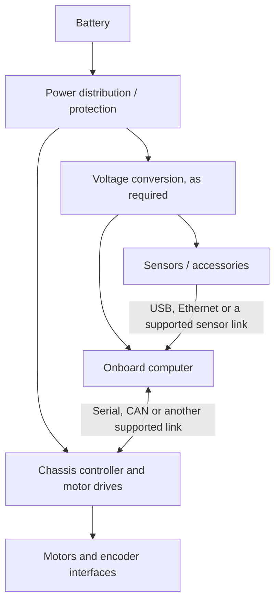

# Electrical Integration Overview

**LucSys Robotics | Power and Signal Architecture**

## 1. Two independent design questions

A mobile robot contains **power connections** and **signal connections**. A device can be electrically powered without having a compatible control or data interface, and a data connector does not imply that it can safely supply the device's required power.

This diagram is a functional reference only. It deliberately omits connector pin assignments and fixed voltage labels because these vary by hardware configuration.

## 2. Power distribution

The battery supplies the robot's electrical energy. Individual devices may require different input voltages and maximum currents. Voltage converters or separate distribution branches may be needed when the battery's operating voltage does not match a device's specified input range.

Before integrating any third-party computer or sensor, confirm:

1. The battery's nominal and full-charge voltage range.
2. The allowable voltage and current at the intended output connector.
3. Power demand during startup, normal operation, and peak load.
4. Connector pinout, polarity, grounding, and available protection.
5. Whether the accessory remains powered during the selected emergency-stop or power-off state.

Do not connect a device directly to a battery or auxiliary power port based only on a similar-looking wiring diagram from another platform.

## 3. Host-computer to chassis connection

A common integration pattern connects an onboard ROS computer to the chassis controller through a supported serial link. Certain controller configurations also provide CAN communication. The actual connector, USB-to-serial device, baud rate, CAN bit rate, and firmware protocol are model- and controller-dependent.

A successful integration requires both an electrical connection and a matching software protocol. A USB connector may expose a serial device rather than a native USB application interface.

## 4. Sensor connectivity

Perception devices may connect through USB, Ethernet, or other interfaces, depending on the sensor. Some devices draw power from the data port, while higher-power sensors may need a separate power connection. A USB hub expands the number of ports but does not necessarily increase the upstream computer's available bandwidth or power budget.

When planning a sensor package, check the sensor's interface standard, power needs, physical mounting, field of view, time synchronization requirements, and software drivers.

## 5. Controller and drive signals

The chassis controller typically receives a high-level motion target and manages the lower-level drive and steering actuation. Encoder measurements can close local speed-control loops and support body-velocity estimation. IMU data, where available, may be provided to the host for higher-level processing.

The exact wiring between controller, motor drivers, encoders, steering actuators, and safety devices depends on the installed hardware. It should be taken from the configuration-specific connection drawing.

## 6. Product-specific connection references

LucSys Robotics has a corresponding electrical integration reference for the following platform groups:

| Platform | Reference scope |
|---|---|
| LSR100 | LSR100 chassis and onboard wiring layout |
| LSR200 | LSR200 chassis and onboard wiring layout |
| LSR300mini | LSR300mini chassis and onboard wiring layout |
| LSR300pro | LSR300pro chassis and onboard wiring layout |
| E550 Series | Educational robot wiring; exact drivetrain and options must be identified |
| LSR550 4WD | DC-motor four-wheel-drive chassis wiring |

The model association above is established, but the reference drawings are **not included in this public overview**. Exact pinouts, voltages, connector locations and accessories can depend on the shipped hardware configuration. Use the correct product-specific drawing when making physical connections.

## 7. Safe integration process

- Inspect the specific product's wiring and pinout documentation before connecting auxiliary equipment.
- Verify supply voltage and polarity with appropriate instruments before power-up.
- Check host-controller direction signs and communication settings with traction disabled or the robot safely supported.
- Confirm emergency-stop behavior, communication-loss handling, and remote-control handover on the delivered firmware.
- Validate all configured motion modes at low command speeds in a controlled test area.

**Important:** Communication loss, software stop commands, and hardware emergency-stop functions are not automatically equivalent. Their behavior must be established for the exact robot and firmware.
