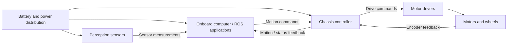

# Hardware and System Overview

**LucSys Robotics | Wheeled Mobile Robot Platforms**

## 1. Functional architecture

A ROS-based mobile robot can be understood as four connected subsystems: **mobility**, **onboard computing**, **perception**, and **power**. Each subsystem has a different role during development and operation.

The diagram illustrates functional relationships, not a product-specific electrical schematic. The actual number of drives, controller ports, sensors, and power converters depends on the selected platform.

## 2. Mobility subsystem

A wheeled chassis generally integrates:

- **Structural frame and wheel assemblies:** the mechanical foundation and wheel-ground contact.
- **Traction motors and, where applicable, steering actuators:** generate wheel rotation and steering motion.
- **Motor drivers:** convert control signals into the electrical outputs required by the actuators.
- **Chassis controller:** receives motion targets, coordinates wheel actuation, and produces available feedback data.
- **Wheel encoders:** provide wheel-motion measurements for speed regulation and odometry estimation, where fitted.
- **Battery and power distribution:** deliver power to the chassis and any connected devices within their electrical limits.

Motor drives and control electronics may be implemented as separate devices or on an integrated controller, depending on the platform.

## 3. Onboard computing

The onboard computer runs the higher-level software stack, such as ROS/ROS 2 applications, sensor processing, mapping, navigation, and supervisory control. The chassis controller handles lower-level motor and wheel control.

Keeping these functions separate can allow an application developer to work at the vehicle-command level rather than implementing individual motor-control loops. The supported host hardware, operating system, ROS distribution, and interface driver must still be checked for the exact platform.

## 4. Perception and state feedback

Different configurations may use wheel encoders, an IMU, laser scanners, cameras, and positioning sensors. Their roles are distinct:

| Data source | Typical information | Integration purpose |
|---|---|---|
| Wheel encoders | Wheel position or speed | Wheel-speed feedback and wheel odometry |
| IMU | Angular velocity and acceleration | Motion estimation and state fusion |
| 2D or 3D LiDAR | Range measurements | Mapping, obstacle detection, navigation |
| RGB or depth camera | Images and/or depth | Visual perception and scene understanding |
| GNSS / RTK receiver | Global position information | Outdoor localization when appropriate |

A sensor appearing in this overview does not mean it is included with every configuration. Available signals, rates, calibration, and coordinate frames depend on the installed hardware and software.

## 5. Coordinate convention

This guide uses the standard planar ROS body-frame convention:

- **+X:** forward
- **+Y:** left
- **+Z:** upward
- **Positive yaw:** counterclockwise viewed from above
- **Linear velocity:** m/s; **angular velocity:** rad/s

When connecting a low-level motion controller, verify its actual direction signs and axis mapping before sending motion commands. The convention in this guide is a system-integration reference, not a claim about every firmware variant.

## 6. Choosing a chassis architecture

| Configuration | Typical planar mobility | Main integration consideration |
|---|---|---|
| Differential drive | Forward/backward and yaw | Wheel spacing, motor direction, and encoder feedback |
| Four-wheel skid steering | Forward/backward and yaw by left/right speed difference | Ground-dependent lateral slip during turning |
| Ackermann steering | Forward/backward and steering-dependent yaw | Wheelbase, steering geometry, and minimum turning radius |
| Mecanum drive | Longitudinal, lateral, and yaw motion | Wheel arrangement, roller orientation, and contact conditions |
| Omnidirectional-wheel drive | Longitudinal, lateral, and yaw motion | Wheel layout and roller/contact geometry |

These are different design families, not interchangeable operating modes on every robot.

## 7. Platform reference coverage

This release includes hardware integration references for **LSR100**, **LSR200**, **LSR300mini**, **LSR300pro**, **E550 Series**, and **LSR550 4WD**. Each model is associated with its respective electrical design reference; a connection drawing for one product must not be applied to another.

The serial and CAN protocol families are shared across the chassis range. Software availability, physical ports, controller revisions and motion capabilities still depend on the selected configuration.

## 8. Information needed for a project-level evaluation

For a specific platform, review its mechanical drawing, rated payload, wheelbase/track, wheel diameter, ground clearance, battery configuration, connector information, supported control modes, and software interface. Exact values should be taken from the corresponding configuration's technical specifications rather than from a generic chassis diagram.
